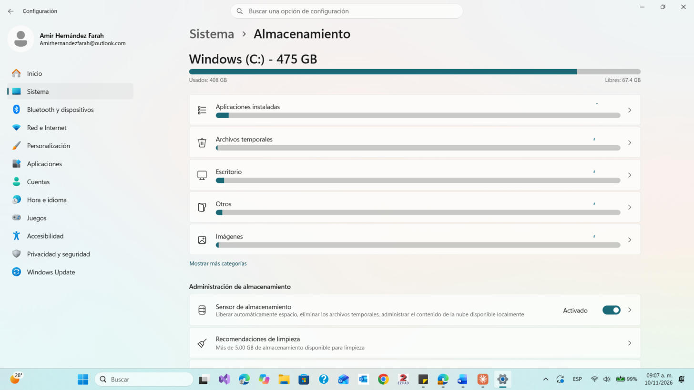
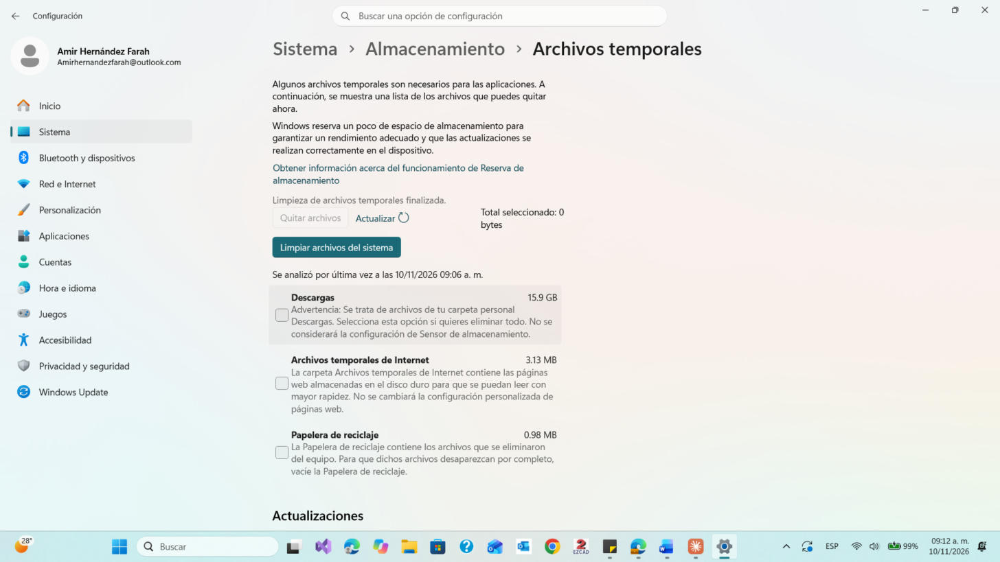

# 💻 Actividad 5 · Diagnóstico y resolución de problemas tecnológicos

**Área 5. Resolución de problemas** · Competencias Digitales · Universidad Anáhuac Mayab

| | |
|---|---|
| **Alumno** | Amir Moisés Hernández Farah |
| **ID** | 584687 |
| **Asesor** | Montserrat Barrita Sánchez |
| **Fecha** | 10 de noviembre de 2026 |

## 🎯 Propósito
Usar una herramienta de diagnóstico del sistema operativo para detectar un problema, aplicar una solución y dejar evidencia de la mejora.

## 🔍 Problema detectado
En **Configuración > Sistema > Almacenamiento** (Windows) el disco C: tenía **408 GB usados de 475 GB** y solo **67.4 GB libres** (alrededor del 86 % lleno). Windows también sugería limpiar más de 5 GB.

## 🛠️ Solución aplicada
Eliminé los **archivos temporales** (optimización de entrega, miniaturas, caché de DirectX, etc.) sin marcar *Descargas* ni la *Papelera*. Son archivos que Windows vuelve a crear solo, así que no se pierden documentos.

## ✅ Resultado
Windows mostró *"Limpieza de archivos temporales finalizada"* y quedaron 0 bytes por quitar (se liberaron unos 640 MB).

## 📸 Evidencias
| Antes | Después |
|---|---|
|  |  |

## 📄 Entrega
[`HERNANDEZ_FARAH_AMIR_MOISES_ACT5.pdf`](HERNANDEZ_FARAH_AMIR_MOISES_ACT5.pdf)
