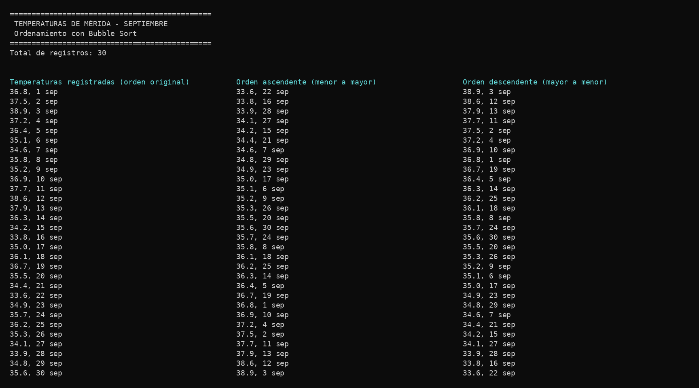

<div align="center">

# 🌡️ P2A5 — Ordenamiento con Bubble Sort

**Estructuras de Datos · Parcial 2 · Universidad Anáhuac Mayab**


</div>

---

## 📌 Instrucciones

Ordenar en orden **ascendente** y **descendente** las temperaturas registradas en la ciudad de **Mérida** durante el mes de **septiembre**, usando el algoritmo de **bubble sort**, y mostrarlas con su fecha.

```
35.2, 9 sep
```

## 🫧 ¿Cómo funciona Bubble Sort?

Se recorre el arreglo comparando cada elemento con su vecino. Si están en el orden incorrecto, se intercambian. En cada vuelta el valor más grande (o más chico, en descendente) "sube" hasta el final, como una burbuja. Si en una vuelta ya no hubo ningún cambio, el arreglo ya está ordenado y se detiene.

| | Ascendente | Descendente |
|---|---|---|
| Se intercambian si... | `arr[j] > arr[j+1]` | `arr[j] < arr[j+1]` |

## 🧩 Clases

| Clase | Qué hace |
|-------|----------|
| `Temperatura` | Guarda los grados, el día y el mes. Su `toString()` da `35.2, 9 sep` |
| `RegistroTemperaturas` | Guarda el arreglo de temperaturas y tiene `ordenarAscendente()` y `ordenarDescendente()` con bubble sort |
| `Main` | Registra las 30 temperaturas de septiembre y muestra los resultados |

## 📂 Estructura

```
P2A5 Ordenamiento (BS)/
├── src/
│   ├── Temperatura.java
│   ├── RegistroTemperaturas.java
│   └── Main.java
├── imagenes/
│   └── salida.png
├── salida.txt
└── README.md
```

## ▶️ Cómo ejecutarlo

```bash
cd src
javac *.java
java Main
```

## 🖥️ Salida

<div align="center">

</div>

---

<div align="center">
Amir Moisés Hernández Farah · Periodo 202660
</div>
