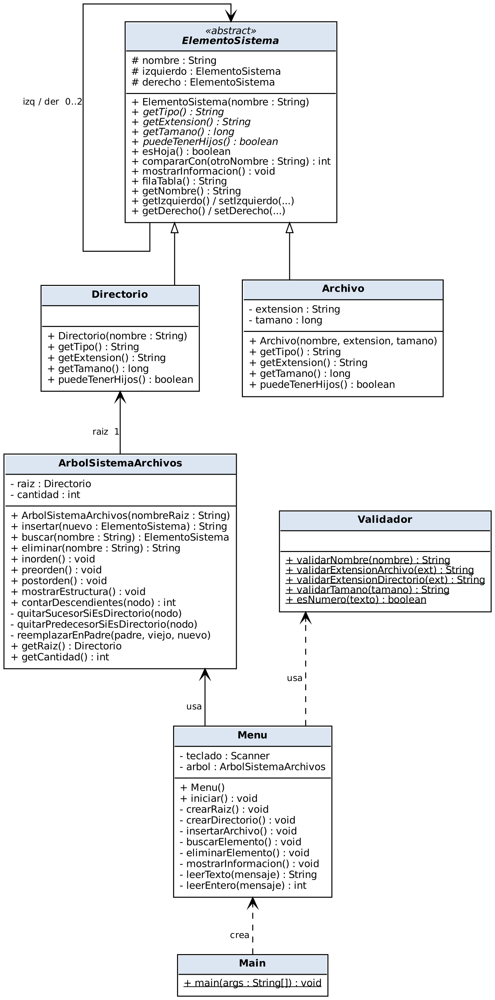

<div align="center">

# 🌳 Proyecto Final — Sistema de Archivos con Árbol Binario de Búsqueda

**Estructuras de Datos · Universidad Anáhuac Mayab**


</div>

---

## 📌 Descripción

Programa en consola que **simula un sistema de archivos** usando un **Árbol Binario de Búsqueda (ABB)**.
Cada nodo del árbol es un **directorio** 📁 o un **archivo** 📄, y se ordenan alfabéticamente por su nombre.

## ✨ Funcionalidades

| # | Opción | Descripción | Estado |
|---|--------|-------------|--------|
| 1 | Crear directorio | Inserta una carpeta en el ABB | ✅ |
| 2 | Insertar archivo | Inserta un archivo (nombre, extensión, tamaño) | ✅ |
| 3 | Buscar elemento | Busca por nombre y muestra su información | ✅ |
| 4 | Eliminar elemento | Situación 1 (hoja), 2 (un hijo) y 3 (dos hijos) | 🚧 |
| 5-7 | Recorridos | Inorden, preorden y postorden | 🚧 |
| 8 | Información | Datos del elemento y sus hijos | 🚧 |

> ✅ terminado · 🚧 en desarrollo

## 🧩 Diseño orientado a objetos

```
            ElementoSistema  (abstracta)
               ▲         ▲
        Directorio     Archivo
ArbolSistemaArchivos ── raiz: Directorio
Menu ──► ArbolSistemaArchivos, Validador
Main ──► Menu
```

<div align="center">

</div>

## 📂 Estructura

```
ProyectoFinal/
├── Codigo/
│   ├── ElementoSistema.java      # nodo del árbol (clase padre)
│   ├── Directorio.java           # hereda de ElementoSistema
│   ├── Archivo.java              # hereda de ElementoSistema
│   ├── ArbolSistemaArchivos.java # el ABB y sus operaciones
│   ├── Validador.java            # funciones de validación
│   ├── Menu.java                 # menú interactivo
│   └── Main.java                 # punto de entrada
└── docs/
    ├── Avance_Proyecto_Arboles_Sistema_de_Archivos.docx
    └── diagrama_clases_uml.png
```

## ▶️ Cómo ejecutarlo

```bash
cd Codigo
javac *.java
java Main
```

## 👥 Equipo

- Amir Moisés Hernández Farah
- Marco Antonio Gómez Fuentes
- Emiliano Peniche Correa
- Rodrigo Quijano López
