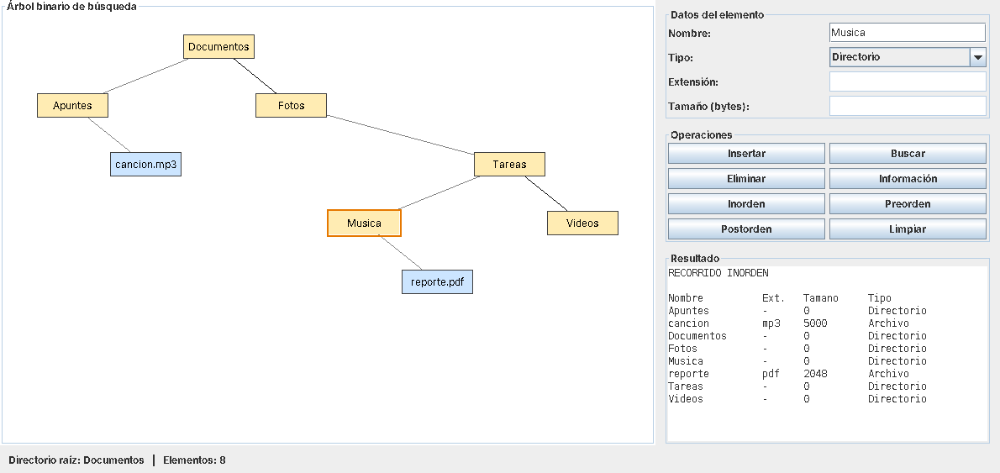
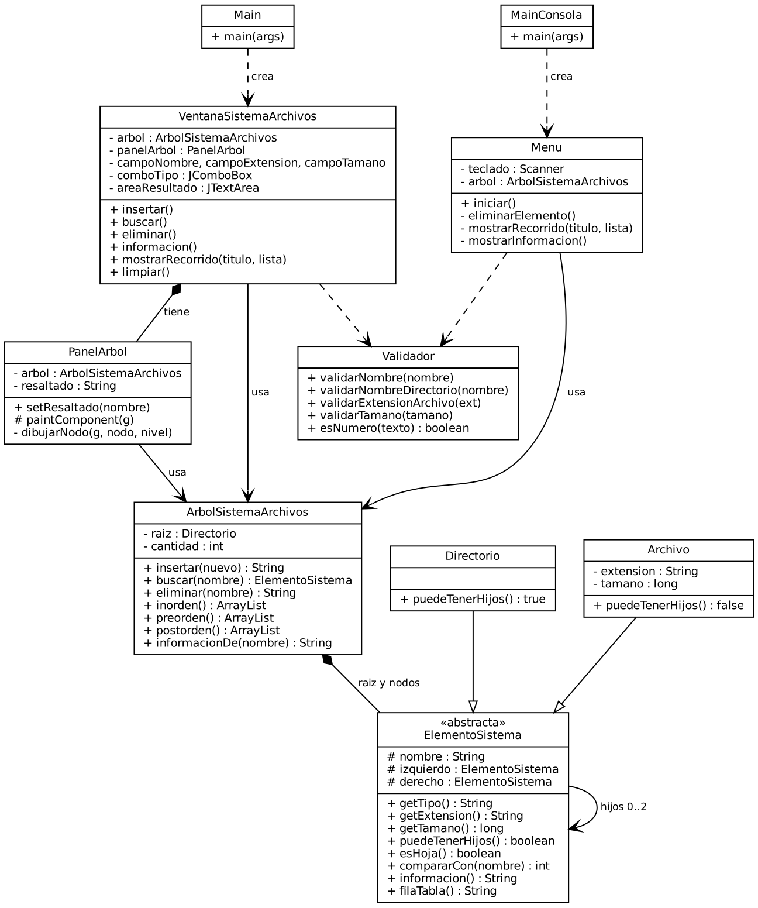

<div align="center">

# 🌳 Proyecto 5 — Sistema de Archivos con Árbol Binario de Búsqueda

**Estructuras de Datos · Universidad Anáhuac Mayab**


</div>

---

## 📌 Descripción

Programa en **modo gráfico** (Java Swing) que **simula un sistema de archivos** usando un **Árbol Binario de Búsqueda (ABB)**.
Cada nodo del árbol es un **directorio** 📁 o un **archivo** 📄, se ordenan alfabéticamente por su nombre y el árbol se dibuja en la ventana.

<div align="center">

</div>

## ✨ Funcionalidades

| # | Botón | Descripción | Estado |
|---|--------|-------------|--------|
| 1 | Insertar (Directorio) | Inserta una carpeta en el ABB | ✅ |
| 2 | Insertar (Archivo) | Inserta un archivo (nombre, extensión, tamaño) | ✅ |
| 3 | Buscar | Busca por nombre, muestra su información y lo marca en el dibujo | ✅ |
| 4 | Eliminar | Situación 1 (hoja), 2 (un hijo) y 3 (dos hijos) | ✅ |
| 5-7 | Inorden / Preorden / Postorden | Recorridos en tabla | ✅ |
| 8 | Información | Datos del elemento, sus hijos y si es hoja | ✅ |

## 🧩 Diseño orientado a objetos

```
            ElementoSistema  (abstracta)
               ▲         ▲
        Directorio     Archivo
ArbolSistemaArchivos ── raiz: Directorio
VentanaSistemaArchivos ──► ArbolSistemaArchivos, PanelArbol, Validador
Menu ──► ArbolSistemaArchivos, Validador   (versión de consola)
```

<div align="center">

</div>

## 📂 Estructura

```
5 Proyecto Sistema de Archivos/
├── Codigo/
│   ├── ElementoSistema.java        # nodo del árbol (clase padre)
│   ├── Directorio.java             # hereda de ElementoSistema
│   ├── Archivo.java                # hereda de ElementoSistema
│   ├── ArbolSistemaArchivos.java   # el ABB y sus operaciones
│   ├── Validador.java              # funciones de validación
│   ├── VentanaSistemaArchivos.java # ventana del programa
│   ├── PanelArbol.java             # dibujo del árbol
│   ├── Main.java                   # abre la ventana
│   ├── Menu.java                   # menú de consola
│   └── MainConsola.java            # abre la versión de consola
└── docs/
    ├── Documentación Proyecto 5 Sistema de Archivos.pdf
    ├── Avance_Proyecto_Arboles_Sistema_de_Archivos.docx
    ├── diagrama_clases_uml.png
    └── capturas/
```

## ▶️ Cómo ejecutarlo

```bash
cd Codigo
javac *.java
java Main          # versión gráfica
java MainConsola   # versión de consola
```

## 👥 Equipo

- Amir Moisés Hernández Farah
- Marco Antonio Gómez Fuentes
- Emiliano Peniche Correa
- Rodrigo Quijano López
